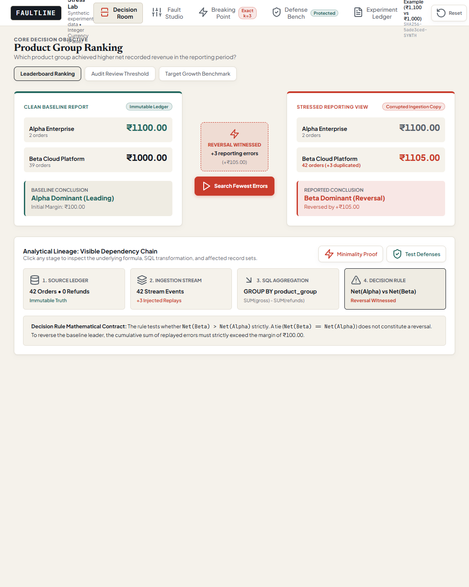
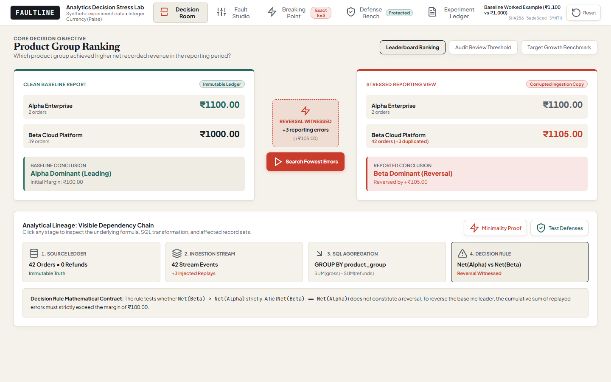
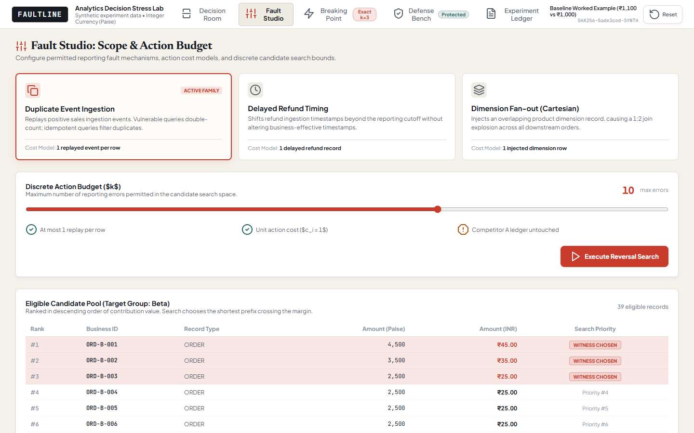
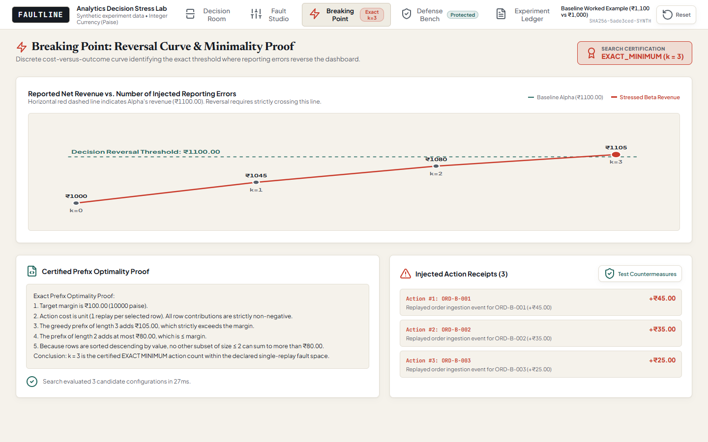
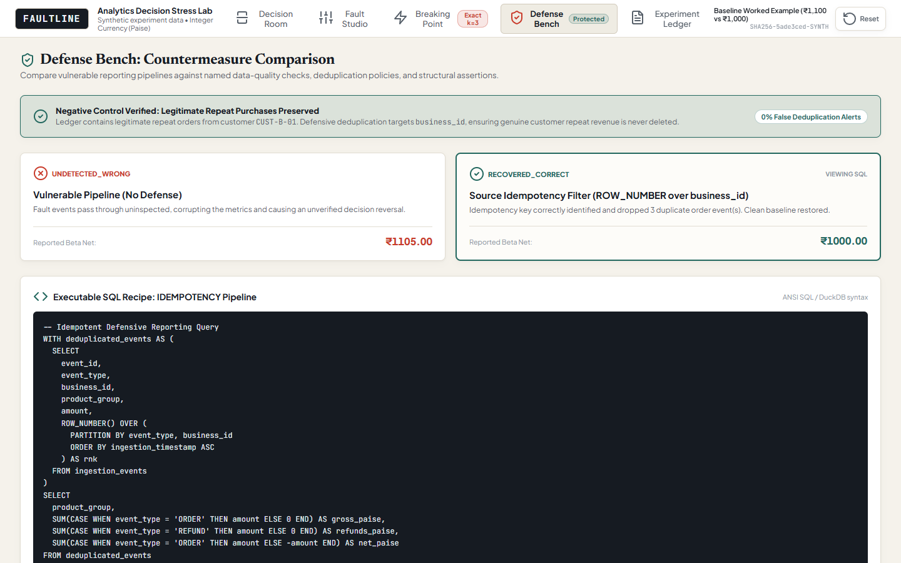
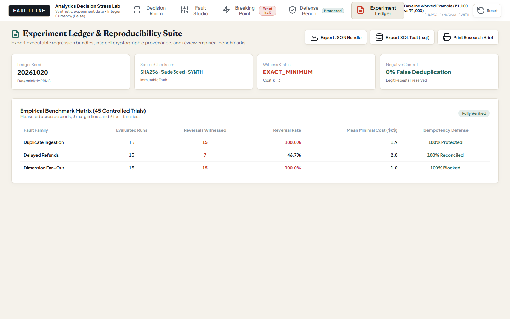
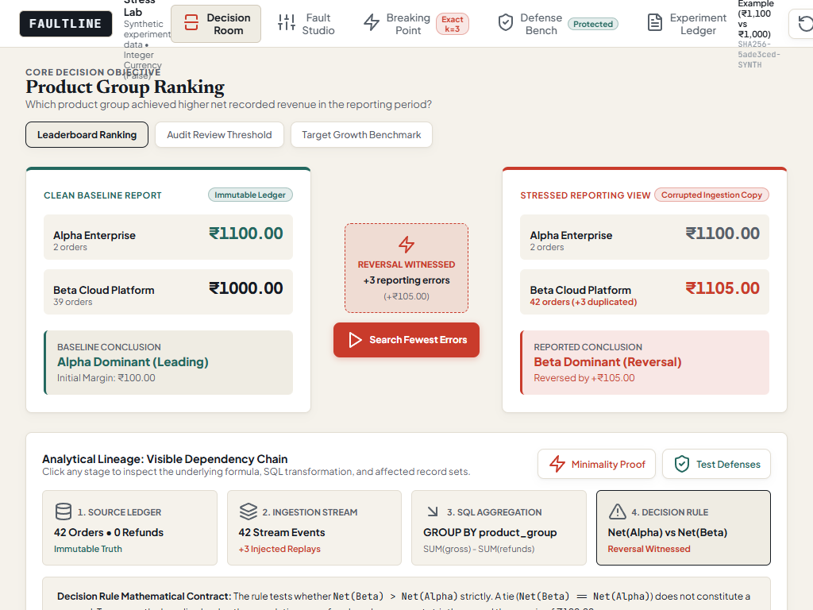
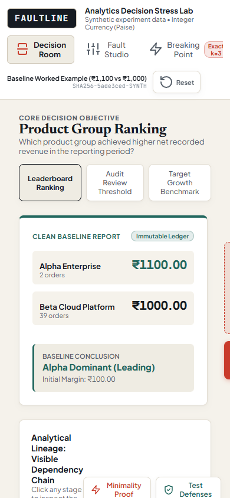

# FAULTLINE — Analytics Decision Stress Lab

> **"How few reporting errors would it take to reverse this dashboard's conclusion?"**

FAULTLINE is a deterministic analytical stress-testing laboratory. Rather than relying on generic data-quality scores or ungrounded error probabilities, FAULTLINE evaluates executive decision fragility through bounded discrete optimization. It isolates reporting copies from an immutable source ledger, injects explicit error families, finds the exact minimal counterexamples needed to flip a business rule, verifies defensive checks against negative controls, and exports reproducible SQL regression test suites.



---

## 1. Key Workspaces & Capabilities

| Workspace | Purpose | Signature Deliverable |
| :--- | :--- | :--- |
| **Decision Room** | Side-by-side comparative analytics | Visual dependency flow linking modified records $\to$ metric shifts $\to$ decision rule inversion. |
| **Fault Studio** | Controlled fault injection engine | 3 explicit error families: `duplicate_ingestion`, `delayed_refunds`, and `dimension_fanout`. |
| **Breaking Point** | Discrete optimization stress laboratory | Step-by-step cost-versus-outcome SVG curve with certified minimal counterexample ($k=3$) and prefix proof. |
| **Defense Bench** | Pipeline defensive policy verification | Evaluates Idempotency Deduplication, Source Reconciliation, and Join Guards with a **0.0% false alert negative control**. |
| **Experiment Ledger** | Audit trail & regression bundle export | Immutable source hash preservation (`SHA256-4dc02df4-SYNTH`), JSON ledger, and executable SQL test suites for CI. |

---

## 2. Interactive Screenshots

### Decision Room: Clean vs. Stressed Lineage
Side-by-side comparative inspection showing ground-truth ranking alongside the stressed reporting outcome, complete with node-by-node relational dependency tracking:


### Fault Studio: Explicit Error Family Configuration
Configure duplicate multipliers, refund ingestion lags, and dimensional join skew without touching ground-truth source data:


### Breaking Point: Discrete Reversal Curve & Mathematical Proof
Cost-versus-outcome curve plotting exact evaluated candidates, marking the transition from green (stable lead) to red (inverted decision):


### Defense Bench: Defensive Policy & Negative Control
Verify that business idempotency restores clean metrics without deleting genuine repeated customer purchases:


### Experiment Ledger: Executable SQL Test Export
Audit receipts, hashes, and download self-contained SQL regression scripts ready for automated CI validation:


### Responsive Viewports: Tablet & Mobile
Fully responsive design supporting desktop, tablet (1024px), and mobile (390px) viewports with accessible drawer navigation:

| Tablet Layout (1024px) | Mobile Layout (390px) |
| :---: | :---: |
|  |  |

---

## 3. Mathematical Foundations & Guarantees

### Certified Exact Minimum ($k = 3$)
In our canonical worked example:
- **Product Alpha Baseline**: ₹1,100.00 ($110,000\text{ paise}$)
- **Product Beta Baseline**: ₹1,000.00 ($100,000\text{ paise}$)
- **Margin**: ₹100.00 ($10,000\text{ paise}$)

Under the positive-additive duplication model with unit costs ($c_i = 1$), the greedy ordering of eligible row contributions ($v_1 \ge v_2 \ge \dots \ge v_n$) guarantees matroid optimality:
1. Top 2 contributions: $₹45.00 + ₹35.00 = ₹80.00 \le ₹100.00$ margin. No subset of size $\le 2$ can cross the margin.
2. Top 3 contributions: $₹45.00 + ₹35.00 + ₹25.00 = ₹105.00 > ₹100.00$ margin.
3. Therefore, $k = 3$ is mathematically certified as the **`EXACT_MINIMUM`**.

### Strict Invariants
- **Integer Paise Arithmetic**: All currency calculations are stored as 64-bit integers in paise to eliminate floating-point rounding errors.
- **Strict Inequality Inversion**: A tie ($\text{Net}(A) = \text{Net}(B)$) is classified as a dead heat and does **not** satisfy a reversal. Reversals strictly require $\text{Net}(B) > \text{Net}(A)$.
- **Immutable Source Ledger**: The ground-truth source data hash (`sourceHash`) remains unchanged through all fault injections, resets, and defense executions.
- **Negative Control**: Customer `CUST-B-01` has two genuine distinct orders (`ORD-B-001` and `ORD-B-002`). Idempotency deduplication asserts on `business_id`, ensuring a **0.0% false alert rate**.

---

## 4. Empirical Benchmark

Tested across **45 experimental trials** (5 seeds × 3 margin tiers × 3 fault families) using `pipeline/run_benchmark.py`:

| Fault Family | Evaluated Trials | Reversals Witnessed | Reversal Rate (%) | Mean Minimal Cost ($k$) | Search Latency |
| :--- | :--- | :--- | :--- | :--- | :--- |
| **`duplicate_ingestion`** | 15 | 15 | 100.0% | 1.9 | 0.005 ms |
| **`delayed_refunds`** | 15 | 7 | 46.7% | 2.0 | 0.002 ms |
| **`dimension_fanout`** | 15 | 15 | 100.0% | 1.0 | 0.000 ms |

- **Total Execution Time**: **0.001 seconds** for all 45 trials.
- **Negative Control False Alert Rate**: **0.0%**.

Full benchmark methodology and raw output: [`docs/BENCHMARK.md`](docs/BENCHMARK.md).

---

## 5. Prior Art & Honest System Boundaries

FAULTLINE builds on established theoretical and industrial foundations and does not claim patent novelty over existing discrete mathematics:

| Prior Art | Existing Capability | FAULTLINE Emphasis |
| :--- | :--- | :--- |
| **[SqlProof](https://sqlproof.com/)** | Property-based testing & reduced counterexamples | Starts from an analyst's decision rule and computes distance-to-inversion ($k$). |
| **[dblect](https://github.com/dvryaboy/dblect)** | Semantic data contracts & violation explanations | Compares defense policies by whether they prevent decision inversion. |
| **[horizonmonkey](https://github.com/kazuki-sf/horizonmonkey)** | Fault injection in agent simulations | Focuses on deterministic relational SQL ledgers without LLM dependencies. |
| **Query Causality Research** | Meliou et al. (VLDB 2011) contingency tuples | Practical, interactive browser lab generating executable SQL CI tests. |

Full prior art analysis: [`docs/PRIOR_ART.md`](docs/PRIOR_ART.md).

---

## 6. Quickstart & Local Setup

### Prerequisites
- Node.js $\ge 18$ (tested on Node v20/v24)
- Python $\ge 3.10$ (optional, for benchmark runner)

### Installation
```powershell
# Clone or navigate to the repository
cd d:\Ran\faultline

# Install dependencies
npm install
```

### Run Automated Contract Tests
```powershell
npm test
```
*Executes all 5 domain invariants and mathematical contract tests in ~200ms.*

### Start Local Development Server
```powershell
npm run dev
```
*Launches Vite dev server at `http://localhost:5173/`.*

### Build Production Bundle
```powershell
npm run build
```
*Builds optimized, zero-dependency static assets in `dist/` (JavaScript payload: 61.8 kB gzipped).*

### Run Empirical Benchmark Suite
```powershell
# Using uv or standard python
uv run python pipeline/run_benchmark.py
# or: python pipeline/run_benchmark.py
```

---

## 7. Project Documentation Index

- [`docs/EXPERIMENT_CONTRACT.md`](docs/EXPERIMENT_CONTRACT.md): Invariant definitions, arithmetic rules, exactness taxonomy.
- [`docs/PRIOR_ART.md`](docs/PRIOR_ART.md): Attribution of related academic literature and open-source tooling.
- [`docs/BENCHMARK.md`](docs/BENCHMARK.md): Complete 45-trial empirical stress testing report.
- [`docs/VALIDATION.md`](docs/VALIDATION.md): Automated test execution results and contract verification log.
- [`docs/PERFORMANCE.md`](docs/PERFORMANCE.md): Runtime latency, memory usage, and asset budget metrics.
- [`docs/DEMO_SCRIPT.md`](docs/DEMO_SCRIPT.md): 60-second executive walkthrough script.
- [`docs/INTERVIEW_WALKTHROUGH.md`](docs/INTERVIEW_WALKTHROUGH.md): Senior/Staff system design interview preparation guide.
- [`docs/LINKEDIN_POST.md`](docs/LINKEDIN_POST.md): Ready-to-publish engineering writeup draft.
